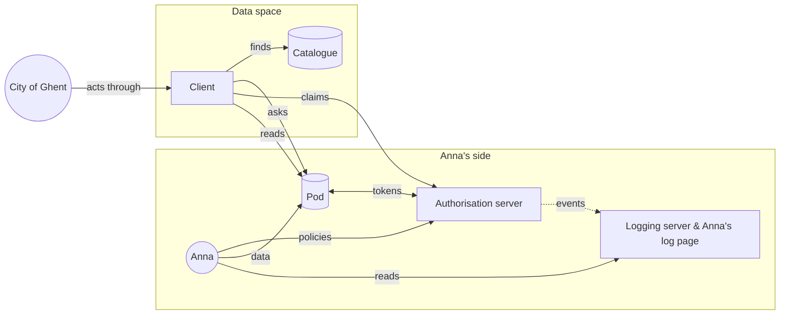

# D2.3 - Solid pods and data spaces

**HARNESS: Deliverable D2.3 - Tools for Governance of Data and AI Services**  

Proof-of-concept: a citizen's data flows from her Solid pod into a data space only as her machin-readble policies allow. Every decision is recorded so she and auditor can check afterwards

## What this does

A person (here Anna) keeps here smart-meter readings in her Solid pod abd writes policies on who may read them and why. When a particpant in a data space wants her data:

1. Discovery: The participant finds Anna's dataset in the data space's catalogue which lists the purposes she accepts.
2. Request: The participant's asks the pod and is sent to Anna's authorisation server where it states who it is and its purpose.
3. Decision: The auth. server evaluates Anna's policies, the purpose and any existing constraints (e.g temporal). Refusal or token granting occurs here.
4. Record: Each step is written to a log that Anna can read, with the rule that decided.


## Architecture



## Status

| Part                                    | State                        | Where                            |
| --------------------------------------- | ---------------------------- | -------------------------------- |
| Legal requirements                      | draft                        | `requirements/`                  |
| Scenario and architecture               | draft                        | `docs/`                          |
| Synthetic meter data                    | done                         | `demo/`                          |
| Logging component (model, server, page) | draft                        | pull request `logging-component` |
| Catalogue                               | planned (week of 9 November) |                                  |
| Client and run script                   | planned                      |                                  |
| Policies and test cases                 | planned                      |                                  |
| Setup guide, screencast, release        | planned (by 27 November)     |                                  |


## Quick start


Generate the synthetic meter data (Python 3.8 or later, standard library only):
```bash
# Clone this repo
git clone https://github.com/odrl-force/harness-d2.3-governance-tools.git
cd harness-d2.3-governance-tools
python demo/generate_meter_data.py --synthetic
```

[TODO]
Instructions for the other components are added as each one is reviewed and merged.

## Project structure

```
.
.
├── README.md
├── LICENSE                    # MIT
├── docs/
│   ├── architecture.md        # draft, being updated
│   └── demo-scenario.md       # draft, being updated
├── requirements/
│   └── legal-requirements.md  # draft, awaiting review
└── demo/
    ├── README.md              # data synthesis process, vocabulary, UCI attribution
    ├── generate_meter_data.py
    └── meter-readings.ttl
```

## Components used

| Component                | Role                                       | Maintainer | Repository                                                                                         |
| ------------------------ | ------------------------------------------ | ---------- | -------------------------------------------------------------------------------------------------- |
| Community Solid Server   | the pod                                    | IDLab      | https://github.com/CommunitySolidServer/CommunitySolidServer                                       |
| UMA authorisation server | holds the policies, decides, issues tokens | IDLab      | https://github.com/SolidLabResearch/user-managed-access/blob/main/documentation/getting-started.md |
| ODRL evaluator           | evaluates requests against ODRL policies   | IDLab      | https://w3id.org/force/evaluator                                                                   |
| ODRL validator           | checks that a policy is well-formed        | IDLab      | https://w3id.org/force/validator                                                                   |
| LOAMA                    | for writing and managing policies          | IDLab      | https://github.com/SolidLabResearch/loama/tree/feat/odrl                                           |

## Use case

Utility data in a smart city. Anna's monthly electricity readings sit in her pod.

- **Flow 1, data altruism (DGA).** The City of Ghent reads them to improve public services,
  until a set date. Whether the City should be presented as a recognised data altruism
  organisation is under discussion.
- **Flow 2, sharing at the user's request (Data Act Art. 5).** A company Anna chooses reads
  them to advise her on her energy use. Requester and policy to be defined.
- **Refusal.** Nobody may read them for marketing or advertising.

## Related work

- [ODRL Profile for Access Control (OAC)](https://w3id.org/oac)
- [Data Privacy Vocabulary (DPV)](https://w3id.org/dpv)
- [TBD]

## Team

| Name                    | Affiliation      | Role                                      |
| ----------------------- | ---------------- | ----------------------------------------- |
| Marlin Kisia            | UGent-IDLab-imec | Lead, requirements, implementation        |
| Beatriz Esteves         | UGent-IDLab-imec | Supervisor-Reviewer, ODRL/Solid expertise |
| Meem Arafat Manab       | UPM              | [TBD]                                     |
| Víctor Rodríguez-Doncel | UPM              | Project coordinator, submission           |
| Harshvardhan Pandit     | ADAPT-TCD        | WP2 Coordinator-Reviewer                  |
| Célestine Lecat         | UNIBO            | [TBD]                                     |
| Fabian Linde            | UPM              | [TBD]                                     |
| Sheyla Leyva-Sánchez    | UPM              | [TBD]                                     |
| Victoria Wiegand        | ADAPT-TCD        | [TBD]                                     |


## Licence

MIT License (publicly funded research)

## Acknowledgements

This work is part of the HARNESS project, funded by the European Union under the Marie
Skłodowska-Curie Actions, grant agreement 101169409.
