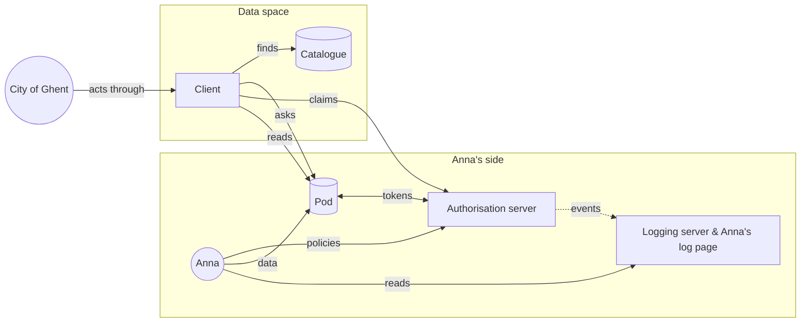

# HARNESS: Deliverable D2.3 - Tools for Governance of Data and AI Services

Work in progress. First release (v0.1.0) planned for 27 November 2026.

## What this does

A person (here Anna) keeps her smart-meter readings in her Solid pod and writes policies on who may read them and why. When a participant in a data space wants her data:

1. Discovery: The participant finds Anna's dataset in the data space's catalogue which lists the purposes she accepts.
2. Request: The participant asks the pod and is sent to Anna's authorisation server where it states who it is and its purpose.
3. Decision: The auth. server evaluates Anna's policies, the purpose and any existing constraints (e.g., temporal). Refusal or token granting occurs here.
4. Record: each step goes to the logging server and Anna reads it on her log page.

## Architecture



## Status

| Part                             | State                        | Where                           |
| -------------------------------- | ---------------------------- | ------------------------------- |
| Legal requirements               | draft                        | [requirements](./requirements/) |
| Synthetic meter data             | done                         | [demo](./demo/)                 |
| Logging component                | draft                        | [logging](./logging/)           |
| Pod and authorisation server     | runs from a pinned submodule | [stack](./stack/)               |
| Catalogue                        | draft                        | [catalog](./catalog/)           |
| Client and start script          | draft                        | [client](./client/)             |
| Policies and test cases          | draft                        | [policies](./policies/)         |
| Setup guide, screencast, release | planned (by 27 November)     |                                 |


## Quick start

Needs Linux or WSL, Git and Node.js 24.

```bash
git clone --recurse-submodules https://github.com/odrl-force/harness-d2.3-governance-tools.git
cd harness-d2.3-governance-tools
npm install
npm start          # pod, UMA, catalogue and logging server
```

Then, in a second terminal:

```bash
npm run story      # the demo; Anna's page is at http://localhost:5100/
```


## Components used

| Component                | Role                                              | Maintainer | Repository                                                                                         |
| ------------------------ | ------------------------------------------------- | ---------- | -------------------------------------------------------------------------------------------------- |
| Community Solid Server   | the pod                                           | IDLab      | https://github.com/CommunitySolidServer/CommunitySolidServer                                       |
| UMA authorisation server | holds the policies, decides, issues tokens        | IDLab      | https://github.com/SolidLabResearch/user-managed-access/blob/main/documentation/getting-started.md |
| ODRL evaluator           | evaluates requests against ODRL policies          | IDLab      | https://w3id.org/force/evaluator                                                                   |
| ODRL validator           | checks that a policy is well-formed               | IDLab      | https://w3id.org/force/validator                                                                   |
| LOAMA                    | for writing and managing policies with Solid pods | IDLab      | https://github.com/SolidLabResearch/loama/tree/feat/odrl                                           |

## Components created for D2.3

| Component    | Role                                                         | Folder     |
| ------------ | ------------------------------------------------------------ | ---------- |
| Logging      | hash-chained event log and Anna's page                       | `logging/` |
| Catalogue    | DCAT catalogue with ODRL offers                              | `catalog/` |
| Client       | plays the demo story and names the rule behind each decision | `client/`  |
| Start script | starts the pod, UMA, catalogue and logging with one command  | `stack/`   |


## Use case

Utility data in a smart city. Anna's monthly electricity readings sit in her pod.

- **Flow 1, data altruism (DGA).** The City of Ghent reads them to improve public services,
  until a set date. Whether the City should be presented as a recognised data altruism
  organisation is under discussion.
- **Flow 2, sharing at the user's request (Data Act Art. 5).** EnerCo, a made-up
  energy-advice company, reads them to advise her on her energy use.
- **AI service (listed only).** EnerCo offers a household electricity forecast. Anyone may
  use it for advice on their energy use. Nobody may use it for credit checking, a high-risk
  use under the AI Act.
- **Refusal.** Nobody may read them for marketing or advertising.
- **A second household.** Bob keeps his readings in his own pod. His rules let anyone read
  them for scientific research, until a set date.

## Related work

- [DPV-ODRL Profile](https://dev.dpvcg.org/mappings/odrl/)
- [Data Privacy Vocabulary (DPV)](https://w3id.org/dpv)

## Team

| Name                    | Affiliation      | Role                               |
| ----------------------- | ---------------- | ---------------------------------- |
| Marlin Kisia            | UGent-IDLab-imec | Lead, requirements, implementation |
| Beatriz Esteves         | UGent-IDLab-imec | Supervisor-Reviewer                |
| Meem Arafat Manab       | UPM              | Catalogue                          |
| Víctor Rodríguez-Doncel | UPM              | Project coordinator, submission    |
| Harshvardhan Pandit     | ADAPT-TCD        | WP2 Coordinator-Reviewer           |
| Célestine Lecat         | UNIBO            | Legal requirements                 |
| Fabian Linde            | UPM              | Fresh-clone testing                |
| Sheyla Leyva-Sánchez    | UPM              | Client                             |
| Victoria Wiegand        | ADAPT-TCD        | Deliverable text                   |


## Acknowledgements

This work is part of the HARNESS project, funded by the European Union under the Marie
Skłodowska-Curie Actions, grant agreement 101169409.
Beatriz Esteves is a postdoctoral fellow of the Research Foundation Flanders (12AGB27N).
